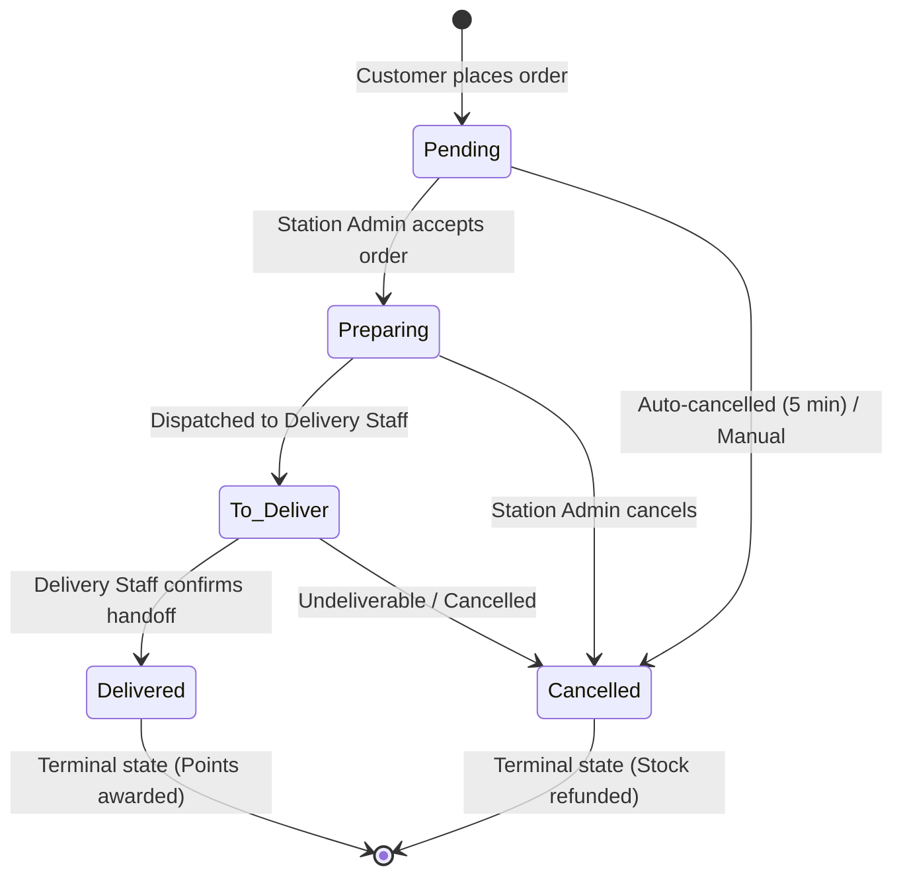

# Mababanaba Waters - Business Logic, Transactions & Data Integrity

**Document ID:** SEC-AUDIT-04  
**Project:** Mababanaba Waters Multi-Station Refilling System  
**Audit Scope:** Server-side Pricing, Inventory Mutexes, Container Debt Accounting, Loyalty Tiers, Order State Machine  

---

## 1. Server-Side Pricing & Cart Recomputation

A fundamental tenet of e-commerce security is **zero trust in client-submitted financials**:
- The client browser submits only `product_id`, `quantity`, `container_option`, `jug_type`, and `use_points` boolean.
- The server (`CustomerController::placeOrder`) ignores any client-supplied totals, unit prices, shipping fees, or discounts.

### Recomputation Workflow
1. **Station & Product Verification:**
   - Verifies the selected station is `Active` and open (checking operating hours `opening_time` to `closing_time`).
   - Fetches unit prices directly from `PRODUCTS` where `product_id IN (...)` and `station_id = ?` and `status = 'Active'`.
2. **Shipping & Jug Fees:**
   - Queries `shipping_fee` and `new_jug_price` directly from the `STATION` record.
   - If `container_option === 'new'`, adds `new_jug_price` per quantity.
3. **Points Discount:**
   - 10 points = 1 free refill container (`discount_amount = product_price`).
   - Caps total order cost such that `total_price >= 0` always.

---

## 2. Inventory Concurrency & Locking Mutexes

Water inventory consists of general bulk stock (`stock_level`), Round containers (`round_jugs`), and Slim containers (`slim_jugs`).

### Concurrency Protection (`SELECT ... FOR UPDATE`)
```php
$stmt = $this->pdo->prepare("SELECT stock_level, round_jugs, slim_jugs FROM INVENTORY WHERE station_id = ? FOR UPDATE");
$stmt->execute([$sid]);
$inv = $stmt->fetch();

if (!$inv || (int)$inv['stock_level'] < $totalQty) {
    throw new Exception("Insufficient general stock.");
}
if ($totRound > 0 && ((int)$inv['round_jugs'] < $totRound)) {
    throw new Exception("Insufficient round jug stock.");
}
if ($totSlim > 0 && ((int)$inv['slim_jugs'] < $totSlim)) {
    throw new Exception("Insufficient slim jug stock.");
}
```

### Properties Verified
- **Atomicity:** Row locking prevents race conditions when concurrent customers attempt to order the final remaining container.
- **Underflow Immunity:** Stock can never drop below zero.
- **Rollback Guarantee:** If any step fails (e.g. payment failure, customer validation error), `$this->pdo->rollBack()` restores state cleanly.

---

## 3. Container Debt Safeguard & Swap Failure Handling

Customers may choose among three container options:
1. `owned`: Customer exchanges an existing empty jug for a refilled jug.
2. `borrow`: Customer borrows a station jug without paying a jug purchase fee.
3. `new`: Customer purchases a brand new jug at the station's `new_jug_price`.

### Debt Safeguard Logic
To prevent container loss, customers with unreturned borrowed containers are restricted from borrowing additional jugs:
```sql
SELECT COUNT(*) FROM ORDERS 
WHERE customer_id = ? AND station_id = ? 
  AND borrow_status = 'Pending' 
  AND (borrow_round > 0 OR borrow_slim > 0)
```
If this count exceeds 0, the order is aborted with:
`"You have unreturned borrowed containers from this station. Please return them before borrowing additional containers."`

### Swap Conversion at Delivery (`DeliveryStaffController::updateOrderStatus`)
When an order was placed as `owned`, but the customer cannot provide an empty jug upon rider arrival:
1. The delivery staff unchecks `jugs_returned` in the delivery modal.
2. The server executes:
   ```sql
   UPDATE ORDERS 
   SET container_option = 'borrow', 
       borrow_round = IF(jug_type='Round', quantity, 0), 
       borrow_slim = IF(jug_type='Slim', quantity, 0), 
       borrow_status = 'Pending' 
   WHERE order_id = ? AND station_id = ? AND container_option = 'owned'
   ```
3. The order is automatically converted into tracked container debt, preventing future borrowing until resolved.
4. When returned later, `markReturned()` updates `borrow_status = 'Returned'` and replenishes station inventory.

---

## 4. Loyalty Points Calculation & Tier Schema

Loyalty points reward repeat customers while maintaining station-specific accounting:

### Calculation Formula
- **Redeemable Points:** $\text{Quantity Delivered} \times 2 - \text{Points Used}$
- **Lifetime Rank Points:** $\text{Quantity Delivered} \times 3$
- **Redemption Rate:** 10 points = 1 free refill unit.

### Domain Schema Clarification: Tier Boundaries
While initial capstone concept notes suggested Classic/Bronze/Silver/Gold/Diamond, the production-tested implementation across `StationAdminController.php`, `ui.js`, and `app.js` establishes the following six tiers:

| Tier Name | Lifetime Points Required | Refill Deliveries Equivalent |
| :--- | :---: | :---: |
| **Normal** | 0 – 29 | 0 – 9 jugs |
| **Bronze** | 30 – 74 | 10 – 24 jugs |
| **Silver** | 75 – 149 | 25 – 49 jugs |
| **Gold** | 150 – 299 | 50 – 99 jugs |
| **Platinum** | 300 – 599 | 100 – 199 jugs |
| **Diamond** | 600+ | 200+ jugs |

*Note for Defense:* Explain to the panel that the 6-tier progression provides granular incentives for frequent households and commercial bulk buyers in Barangay Mababanaba.

---

## 5. Order State Machine & Cancellation Idempotency

### Permitted State Transitions


### Idempotency Enforcement
1. **Delivered State:**
   If an order is already `Delivered`, repeated requests return:
   ```json
   { "success": true, "message": "Order #X is already Delivered.", "already_completed": true }
   ```
   No duplicate points are awarded, and no duplicate inventory operations occur.
2. **Cancellation State:**
   If an order is already `Cancelled`, subsequent requests are rejected (`HTTP 400: Order is already Cancelled`). Stock is refunded exactly once upon first transition.
3. **Automated Expiry Job (`api/cron.php`):**
   Unaccepted `Pending` instant orders older than 5 minutes (`DATE_SUB(NOW(), INTERVAL 5 MINUTE)`) are automatically set to `Cancelled`, and stock reservations are released back into inventory.
