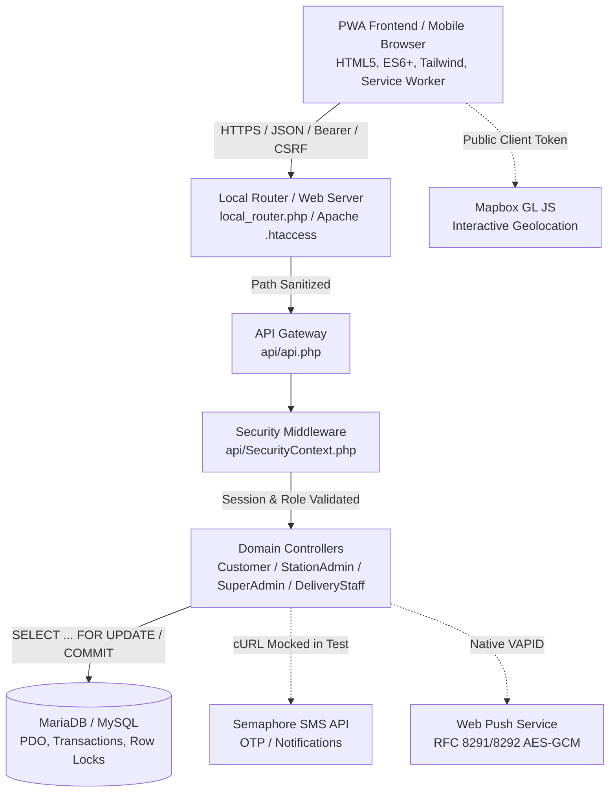

# Mababanaba Waters - Academic Capstone Technical Defense Guide

**Document ID:** SEC-AUDIT-05  
**Project:** Mababanaba Waters Multi-Station Refilling System  
**Purpose:** Technical Defense Reference, Verified Architecture Explanation & Panel Q&A Preparation  

---

## 1. Verified Architecture & End-to-End Request Flow

### Request Flow Explained for the Panel
1. **PWA Layer:** The frontend executes entirely in vanilla JavaScript with no heavy front-end framework. State is managed centrally in `public/js/state.js`, and all server communication flows through `public/js/api.js`.
2. **Server Gateway:** Requests hit `api/api.php`, which verifies:
   - Request origin and CORS headers.
   - CSRF tokens for cookie-authenticated state changes (or validates HMAC-SHA256 Bearer tokens).
   - Strict session state (`use_strict_mode = 1`) and non-revoked account status.
3. **Controller Execution:** Domain-specific business logic is isolated in dedicated controller classes. Each action validates caller role and enforces station scoping (`station_id`).
4. **Data Persistence:** Database mutations utilize PDO prepared statements with transactions (`beginTransaction`, `commit`, `rollBack`) and explicit row-level locking (`FOR UPDATE`) for inventory and loyalty updates.

---

## 2. Endpoint × Role Authorization Matrix

| Endpoint Action | Customer | Delivery Staff | Station Admin | Super Admin | Enforcement Mechanism |
| :--- | :---: | :---: | :---: | :---: | :--- |
| `get_stations`, `get_products` | Allowed | Allowed | Allowed | Allowed | Public / Open catalog |
| `place_order`, `get_my_orders` | **Allowed** | Denied | Denied | Denied | `SecurityContext::requireCustomer()` |
| `update_order_status` | Denied | **Allowed (Assigned)** | **Allowed (Branch)** | Denied | `requireStationStaff()` + rider assignment check |
| `mark_returned` | Denied | **Allowed** | **Allowed** | Denied | `requireStationStaff()` |
| `admin_get_orders`, `admin_get_inventory` | Denied | Denied | **Allowed (Branch)** | Denied | `requireStationAdmin()` (Scoped to `station_id`) |
| `get_users`, `save_station`, `delete_station` | Denied | Denied | Denied | **Allowed** | `SecurityContext::requireSuperAdmin()` |

---

## 3. High-Impact Panel Defense Q&A (22 Verified Questions)

### Q1: How do you prove that a Station Admin cannot view or manipulate another branch's data?
> **Answer:**  
> Multi-tenant isolation is enforced strictly on the server, not trusted from client parameters. When a Station Admin authenticates, their assigned `station_id` is loaded from the authenticated database record (`ADMIN` table) into `$_SESSION['station_id']`. In `StationAdminController.php`, every single query (orders, inventory, sales, products) explicitly appends `WHERE station_id = ?` bound to `$_SESSION['station_id']`. Even if an admin tampers with request bodies or query strings, the server ignores external station parameters and only queries the authenticated branch.

### Q2: What happens if two customers order the last available container at the exact same millisecond?
> **Answer:**  
> We use pessimistic database concurrency control. In `CustomerController::placeOrder()`, before checking stock, the server begins a transaction and executes:  
> `SELECT stock_level, round_jugs, slim_jugs FROM INVENTORY WHERE station_id = ? FOR UPDATE`.  
> MySQL acquires an exclusive row lock on that station's inventory record. The first request reads stock, verifies availability, and deducts the inventory. The second concurrent request is queued at the database level. When the first commits, the second acquires the lock, re-reads the updated stock (now 0), fails the availability check, rolls back, and returns `"Insufficient stock"` without overselling.

### Q3: What prevents a delivered order from awarding loyalty points twice?
> **Answer:**  
> Delivery confirmation in `DeliveryStaffController::updateOrderStatus()` is protected by state machine idempotency. If an order's status is already `Delivered`, the controller immediately exits, returning `{ success: true, message: "Order is already Delivered", already_completed: true }`. Points calculation (`INSERT INTO CUSTOMER_LOYALTY ...`) is only triggered during the singular transition from `To Deliver` to `Delivered`.

### Q4: Can private customer data remain in the Service Worker cache after logout?
> **Answer:**  
> No. In `public/sw.js`, our fetch handler explicitly ignores all requests matching `/api/`, routing them exclusively over the network. Furthermore, upon logout in `public/js/ui.js`, the app explicitly executes `caches.delete()` across all API-related cache buckets, resets `State.authToken = null`, and clears `sessionStorage` and `localStorage`.

### Q5: What is the security risk of storing auth tokens in browser storage, and what mitigation exists?
> **Answer:**  
> Tokens stored in `localStorage` or `sessionStorage` can be accessed by JavaScript, making them vulnerable to token theft if a Cross-Site Scripting (XSS) vulnerability exists. We mitigate this through defense-in-depth:  
> 1. We strictly sanitize and escape all user-rendered HTML using `UI.escapeHTML()` and native `textContent` assignments.  
> 2. We use HttpOnly session cookies alongside HMAC-SHA256 bearer tokens so web sessions do not rely exclusively on client storage.  
> 3. Our Content-Security-Policy disallows untrusted script origins.

### Q6: How are OTP abuse, brute-force guessing, and SMS spending controlled?
> **Answer:**  
> In `SecurityContext::verifyOtp()`, failed OTP verification attempts increment `failed_otp_attempts`. After 5 consecutive failed attempts, the OTP code and expiry are atomically erased (`UPDATE CUSTOMER SET otp_code = NULL ...`), locking the code and preventing brute force. In addition, `rate_limits` restricts requests per IP address, and OTP resend enforces a mandatory cooldown period to protect against SMS gateway exhaustion.

### Q7: What if the network drops right after the server commits an order but before the customer receives the response?
> **Answer:**  
> The order is safely persisted on the server within an ACID transaction. When the customer's PWA reconnects, `App.renderCustomerOrders()` queries the server via `get_my_orders`, pulling the current database state. The customer immediately sees their placed order under their active orders list without double-ordering.

### Q8: How do you recover when the scheduled cron job fails or executes twice concurrently?
> **Answer:**  
> `api/cron.php` is designed to be fully idempotent. When auto-cancelling unaccepted orders older than 5 minutes, it uses transactional state filtering: `WHERE order_status = 'Pending' AND created_at <= DATE_SUB(NOW(), INTERVAL 5 MINUTE)`. If run twice in the same minute, the second execution finds zero matching rows and safely performs zero operations.

### Q9: Which security protections were dynamically tested versus statically reviewed?
> **Answer:**  
> We executed 29 automated test cases against a live local test database (`tests/run_tests.php`), dynamically verifying: path traversal rejection, password hashing, unverified account rejection, token HMAC verification and tampering detection, phone normalization and PII masking, cross-station loyalty isolation, inventory underflow prevention, container debt enforcement, cancellation idempotency, and delivery staff assignment protection. Web Push VAPID and browser manifest behaviors were verified via manual DevTools inspection and static code analysis.

### Q10: How does the container debt safeguard work when a customer cannot provide an exchange jug?
> **Answer:**  
> If an order was placed as `owned` (exchange), but at the doorstep the customer cannot provide an empty jug, the delivery rider unchecks `jugs_returned` in the app. The server converts the order's container option to `borrow`, flags `borrow_status = 'Pending'`, and logs the specific container count in `borrow_round` or `borrow_slim`. Any subsequent order attempt with `container_option = 'borrow'` is blocked by the server until the outstanding debt is returned.

### Q11: How do you prevent SQL Injection across dynamic filters or search parameters?
> **Answer:**  
> We use PDO prepared statements with parameterized placeholders (`?`) across 100% of queries that handle user input. Furthermore, `PDO::ATTR_EMULATE_PREPARES` is set to `false`, guaranteeing that queries and data are sent to MariaDB in separate packets at the protocol level. For sorting or column names that cannot use parameters, we strictly validate input against fixed hardcoded allowlists.

### Q12: Why is CSRF protection needed if bearer tokens are used, and how is it implemented?
> **Answer:**  
> Because the application supports dual authentication (both cookie-based sessions for browser users and Bearer tokens for mobile PWA standalone mode), cookie-authenticated state-changing requests (POST) are vulnerable to Cross-Site Request Forgery. We generate a cryptographically secure token (`random_bytes(32)`) stored in `$_SESSION['csrf_token']` and validate it on every state-changing POST via header `X-CSRF-TOKEN` using constant-time string comparison (`hash_equals`). Bearer token requests are verified cryptographically via HMAC-SHA256.

### Q13: What prevents a delivery rider from marking another rider's delivery as completed?
> **Answer:**  
> In `DeliveryStaffController::updateOrderStatus()`, when an order is in `'To Deliver'` status, the server queries the `DELIVERIES` table for the rider assigned to that order. If the authenticated staff member's `admin_id` does not match the assigned rider, the server rejects the request with HTTP 403 Forbidden: `"Forbidden: This order is assigned to another delivery staff member."`

### Q14: How does the system handle session fixation attacks?
> **Answer:**  
> In `api/api.php`, we set `session.use_strict_mode = 1`, which forces PHP to reject uninitialized session IDs supplied by clients. In addition, upon every successful login in `CustomerController` and `StationAdminController`, the server immediately calls `session_regenerate_id(true)`, deleting the old session identifier and issuing a fresh one.

### Q15: Why are orders and payments not queued offline when the device is disconnected?
> **Answer:**  
> Offline queueing for financial and inventory transactions creates severe race conditions: stock could be sold out by the time the device reconnects, product prices could have changed, or GCash payments could fail validation. To prevent data corruption, `API.request()` explicitly checks `navigator.onLine` and blocks mutation requests offline with an informative toast alert.

### Q16: How are passwords hashed and verified in the database?
> **Answer:**  
> We use PHP's standard `password_hash($password, PASSWORD_DEFAULT)` and `password_verify($password, $hash)`. This utilizes modern Bcrypt with automatic salt generation and adaptive work factor. Passwords are never stored in plaintext, never logged, and never returned in API payloads.

### Q17: What prevents an attacker from executing malicious PHP code uploaded as a GCash QR proof?
> **Answer:**  
> Station QR proofs are validated for image MIME types, assigned randomized server-generated filenames, and stored in `public/uploads/qr/`. We created an `.htaccess` policy in that directory that turns the PHP script engine off (`php_flag engine off`) and explicitly denies access to executable extensions (`.php`, `.phtml`, `.cgi`, etc.).

### Q18: What prevents an unauthenticated user from reading sensitive environment files (`.env`, `.secret_key`)?
> **Answer:**  
> We hardened `local_router.php` and `public/.htaccess` to inspect all incoming URIs. Any request containing directory traversal sequences (`..`), null bytes (`\0`), or targeting files matching `.(env|secret_key|sql|log|bak|ini)` is rejected immediately with HTTP 403 Forbidden.

### Q19: Why does the system use station-scoped loyalty points instead of a global pool?
> **Answer:**  
> Mababanaba Waters operates as a multi-station franchise where physical branches manage their own inventories, operating costs, and profit margins. If points were global, a customer could buy water at Branch A and redeem free refills at Branch B, imposing financial losses on Branch B. Scoping loyalty to each `station_id` ensures accurate accounting.

### Q20: What privacy compliance considerations apply under Philippine law (RA 10173)?
> **Answer:**  
> Under the Data Privacy Act of 2012, customer mobile numbers and delivery coordinates constitute Personal Information. We implemented data minimization by masking phone numbers in `SMS_LOGS` (`0912****789`), excluding exact passwords/OTPs from logs, restricting delivery address access strictly to the assigned delivery staff, and providing clear terms and privacy disclosures upon registration.

### Q21: What happens if a station admin attempts to delete a station that already has historical orders?
> **Answer:**  
> In `SuperAdminController::deleteStation()`, the system queries `SELECT COUNT(*) FROM ORDERS WHERE station_id = ?`. If orders exist, deletion is blocked: `"Cannot delete station with existing order history. Please keep it Suspended instead to preserve historical records."` This protects the audit trail and preserves financial reporting integrity.

### Q22: What are the main remaining security limitations of the current architecture?
> **Answer:**  
> The remaining limitations are operational: Mapbox access tokens are browser-visible public keys (which should be restricted by domain origin in the Mapbox dashboard), and Semaphore SMS delivery relies on an external telecom provider's availability. In a full production environment, we also recommend placing the PHP app behind an Nginx reverse proxy with TLS 1.3 and WAF rate limiting.

---

## 4. Recommended Live Demonstration Script for the Defense

1. **Step 1: Role Isolation Demo**  
   - Log in as Station 1 Admin (`station1_admin`). Show that only Station 1 orders and Station 1 inventory appear.  
   - Attempt to access an order from Station 2 by changing the order ID parameter in DevTools console. Show the clean `404 / 403` error response.
2. **Step 2: Inventory & Concurrency Demo**  
   - Navigate to inventory where Round jugs = 5.  
   - Place an order for 6 Round jugs. Show the immediate server rejection: *"Insufficient round jug stock."*
3. **Step 3: Container Debt & Swap Demo**  
   - Complete a delivery with `jugs_returned` unchecked.  
   - Switch to customer view: show the container debt indicator. Attempt to place another borrow order; show the blocking debt modal.
4. **Step 4: PWA Offline & Service Worker Demo**  
   - Open DevTools Network tab, switch to "Offline".  
   - Refresh the page to show the cached app shell rendering instantly.  
   - Attempt to submit an order: show the offline intercept toast preventing data corruption.
